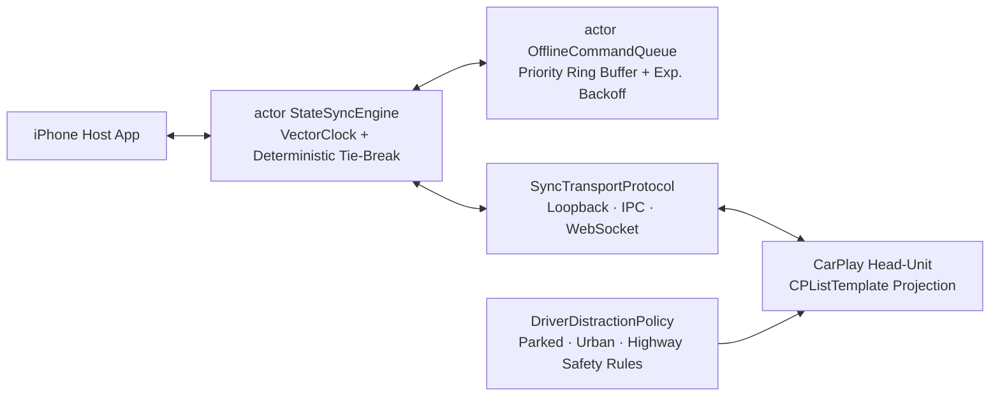

<div align="center">
  
</div>

<p align="center">
  <a href="https://github.com/Bugraciftci/CarPlaySyncKit/actions/workflows/ci.yml"></a>
  <a href="https://github.com/Bugraciftci/CarPlaySyncKit/releases/tag/v2.0.0"></a>
  <a href="https://bugraciftci.github.io/CarPlaySyncKit/documentation/carplaysynckit/"></a>
  
  
  
  
</p>

Real-time **Swift 6 bidirectional state synchronization, vector-clock conflict resolution, bounded priority ring-buffer offline queueing, and speed-aware Apple CarPlay driver-distraction safety policy** engine.

> 📚 **Interactive API Reference:** [CarPlaySyncKit DocC Documentation](https://bugraciftci.github.io/CarPlaySyncKit/documentation/carplaysynckit/)

## Architecture



## Key Engineering Highlights

- **Vector Clock Causality (`VectorClock.swift`):** Detects `.before`, `.after`, `.equal`, and `.concurrent` mutations across iPhone, CarPlay Head-Unit, and Companion nodes without relying on wall-clock skew.
- **Deterministic Driver-First Conflict Resolution (`StateSyncEngine.swift`):** Resolves concurrent edits reproducibly (prioritizing in-cabin head-unit interactions over background phone sync) and broadcasts snapshots over multi-consumer `AsyncStream`.
- **Priority Ring-Buffer Offline Queue (`OfflineCommandQueue.swift`):** Actor-isolated bounded buffer with `.safetyCritical`, `.navigation`, and `.telemetry` lanes, priority-aware backpressure eviction, and exponential backoff replay on reconnect.
- **Speed-Aware CarPlay Safety Policy (`DriverDistractionPolicy.swift`):** Adapts `CPListTemplate` item depth, template hierarchy limits, and keyboard search lockouts dynamically based on `VehicleTelemetry.motionState` while keeping safety-critical actions pinned first.
- **Automotive Head-Unit HUD & Diagnostics Console (`CarPlayHeadUnitView.swift`, `SyncDiagnosticsInspectorView.swift`):** High-contrast SwiftUI cockpit display and `@MainActor` MVVM coordinator (`CarPlayDashboardViewModel`) for inspecting live speed lockouts, vector-clock matrices, and concurrent tunnel partition conflict resolution.
- **Deterministic Drive-Cycle Telemetry Replay (`TelemetryReplaySimulator.swift`):** Reproducible drive profiles (`parkedPreflight`, `urbanStopAndGo`, `highwayCruiseLockout`, `tunnelNetworkPartition`) for automated HMI verification.
- **Payload Integrity Verification (`SyncEnvelope.swift`):** Deterministic 64-bit FNV-1a envelope checksums reject corrupted frames before mutating state.

## Running Tests & Benchmarks (19 XCTest Cases)

Covers vector-clock causal ordering, 100-task priority ring-buffer backpressure stress tests, 5k-iteration FNV-1a envelope integrity throughput benchmarks, and drive-cycle safety lockouts:

```bash
swift test --enable-code-coverage
```

## License

MIT — see [LICENSE](./LICENSE).
